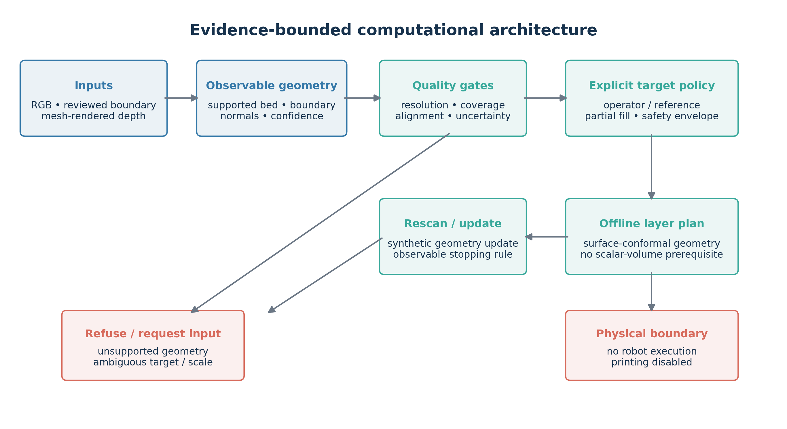

# Bioprinting Pipeline — Evidence-Bounded Computational Framework

> **Project scope:** An uncertainty-aware multimodal computational framework for visible 3D wound reconstruction, sensor routing, failure detection and conservative surface-conformal deposition planning.

The repository contains historical learned models and planner components, plus a completed, evidence-bounded computational study. The reported work evaluates visible geometry, synthetic sensor routes, failure rejection, and offline planning decisions. It does **not** establish clinical wound measurement or autonomous printing.



## What the evidence supports

- **Visible-surface shape evaluation:** selected Syn3DWound and SALVE comparisons. SALVE comparisons use ground-truth (GT) similarity alignment and therefore evaluate shape only; independent metric-scale recovery is **not proven**.
- **Synthetic sensor routing:** depth is rendered from source meshes in dataset units. There is no real D405 wound dataset or physical depth-sensor validation.
- **Failure detection and rejection:** calibration safety was evaluated on synthetic configurations. The strict engineering gate failed; this is not a validated safety system.
- **Reference-surface limits:** the pre-wound healthy surface is not identifiable from current observations. Healthy-disc extrapolation is a lower-bound test only.
- **Conservative architecture decision:** `STAGED_FILL_WITH_OPERATOR_FINAL_TARGET`. The final target remains externally specified; no robot or planner integration was performed.
- **Offline demonstration:** five deterministic software cases, including a three-stage scan/plan/update trace. CoppeliaSim was not run and no physical printing took place.

### Selected sealed results

| Evaluation | Result | Interpretation |
|---|---:|---|
| Syn3DWound surface shape | Mean 3.90% and P95 5.85% of wound width; 92.64% completeness at a 5%-width tolerance | Shape comparison after evaluation-only similarity alignment; not metric-scale recovery |
| SALVE, iPhone / Neuralangelo | 0.0956 mm mean point-to-surface; 99.57% completeness at 1 mm | GT-similarity-aligned shape evaluation only |
| SALVE, Logitech / NeuS-facto | 0.1372 mm mean point-to-surface; 99.15% completeness at 1 mm | GT-similarity-aligned shape evaluation only |
| Clean measurement validity | 0/24 variants accepted | Unknown healthy-skin closure prevents true pre-wound volume identification |
| Healthy-disc hidden-surface TEST | 55 held-out patches from one body model; TPS MAE 0.042% of hole diameter; ensemble coverage 88.32% vs. a 90% target | Lower-bound difficulty estimate, not pre-wound anatomy recovery |
| Final synthetic architecture decision | 18 carved cases; direct-reference gate failed | Select staged partial filling with operator-defined final target |
| Strict calibration holdout | 48 clean, 168 fault configurations; 2/48 clean false alarms | Engineering gate failed; correlated configurations are not independent subjects |

Percentages of wound width, hole diameter, or computed reference volume are not physical measurements. SALVE millimeter values above follow GT-derived similarity alignment and must not be interpreted as independent scale recovery. No inferential confidence intervals are reported because the effective independent sample counts and clustered design do not justify them.

## Reproduction

See [reproduction instructions](docs/reproduction.md), [claims and limitations](docs/claims_and_limitations.md), [dataset provenance](docs/dataset_provenance.md), and the [statistical audit](docs/statistical_audit.md). The [artifact inventory](docs/artifact_inventory.csv) identifies final versus diagnostic materials and commit safety. The metric-level audit is generated at `paper/tables/metric_audit.csv`.

### Final notebook

Open [04_rgb_wound_3d_reconstruction.ipynb](notebooks/04_rgb_wound_3d_reconstruction.ipynb) in Kaggle or Jupyter. Its default `ACTION="REPLAY"` displays sealed results; live actions require the exact dataset and result inputs described in the notebook. The clean notebook retains code and hash-bound records; [04_replay_manifest.json](notebooks/04_replay_manifest.json) records the hashes and sizes of removed embedded outputs.

### Commands (PowerShell)

```powershell
python -m pip install -e ".[dev]"
python -m pytest -q
python scripts/build_publication_package.py --replay
python -m robot.simulation.observable_demo
```

Figure generation uses the compact evidence bundle in `paper/data/`. Regenerating Figure 3 also requires the identified public Syn3DWound RGB example at the path recorded in `paper/data/figure03_provenance.json`. Exporting a fresh evidence bundle requires the sealed local experiment outputs; do not rerun or retune sealed experiments to regenerate the committed package.

To re-export selected evidence when those sealed outputs are available:

```powershell
python scripts/export_publication_evidence.py
python scripts/build_publication_package.py
```

## Data and citations

Raw external datasets, large intermediate results, model checkpoints, and caches are not committed. Follow [dataset provenance and download notes](docs/dataset_provenance.md). The legacy `FUSeg` material and model components are historical code, not evidence for the completed reconstruction and safety results.

The bibliography file is [references.bib](paper/references.bib). A source-by-source literature audit and manuscript-level citation integration remain writing tasks; no unverified citation is presented here as evidence.

## Explicit non-claims

- No CT-style reconstruction or claim of exactly eight orthogonal measurements.
- No certified millimeter wound depth, clinical volume, or true anatomical restoration.
- No validated direct printing instructions, 99% fill accuracy, autonomous healing, or clinically meaningful measurement claim.
- No real D405 wound dataset, physical sensor validation, CoppeliaSim robot execution, or physical printing.
- Printing remains disabled; no printing is authorized.
